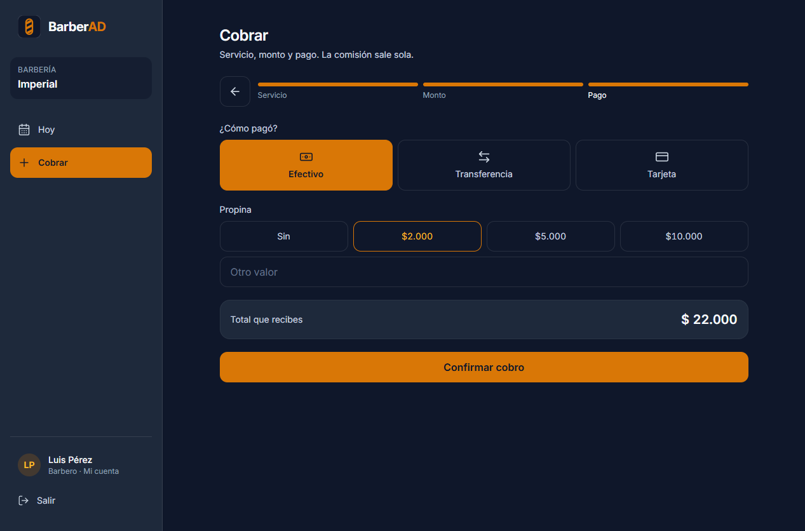

<p align="center">
  
</p>

<p align="center">
  Caja de una barbería para usarla de pie, con el celular en la mano.
</p>

El dueño registra la barbería, arma la carta de servicios, mete al equipo, cobra un corte y cierra la caja del día. Cada barbero entra con su correo y solo ve sus cortes y su comisión.


<table>
  <tr>
    <td width="68%"></td>
    <td width="32%"></td>
  </tr>
  <tr>
    <td>Cobrar: servicio, monto y pago, con la propina aparte.</td>
    <td>El barbero en el celular: su comisión del día.</td>
  </tr>
</table>

## Arrancar

Hace falta Node.js 20 o superior.

```bash
npm install
npm run dev
```

Abre http://localhost:3000

`npm run dev` enciende Postgres en esta máquina, crea la base `barberad` si no existe, aplica las migraciones y levanta la app. Los datos quedan en `data/` y no se suben. El puerto es el 5433, para no chocar con un Postgres que ya tengas. La primera vez descarga el binario y puede tardar.

Entra por http://localhost:3000/registro. La contraseña pide al menos 8 caracteres.

## Qué se puede hacer

**El dueño**

- **Registro.** Su nombre, el de la barbería, el correo y la contraseña.
- **Guía de inicio.** Al entrar, Hoy muestra cuatro pasos: armar la carta, cobrar el primer corte, sumar al equipo y completar los datos de la barbería. Se marcan solos y la guía desaparece cuando están todos, o antes si la oculta.
- **Servicios.** Nombre, duración y precio en pesos enteros. Trae plantillas de un toque (corte clásico, fade, barba, corte + barba, infantil, cejas) y cada servicio se puede editar o desactivar.
- **Equipo.** Cada barbero con su correo, una contraseña inicial y su porcentaje de comisión. Después puede cambiarle la comisión, que aplica desde el siguiente cobro, o ponerle una contraseña nueva si la olvidó.
- **Hoy.** Lo cobrado por método de pago, el ticket promedio, las comisiones que se le deben al equipo, el efectivo que debe haber en la gaveta, los descuentos con su motivo y lo que hizo cada barbero.
- **Caja.** El efectivo esperado contra el contado, con lo que sobra o falta, y los últimos siete cierres. Cerrada, ese día no recibe otro cobro.
- **Mi cuenta.** Teléfono y dirección de la barbería, y el cambio de contraseña.

**El barbero**

- **Cobrar.** Servicio, valor y método: efectivo, transferencia o tarjeta. Si el valor baja del precio, pide el motivo del descuento. La propina va aparte y no entra en la comisión.
- **Hoy.** Su comisión, sus cortes y sus propinas del día. No ve lo de los demás.

**Cualquiera**

- **Recuperar la contraseña.** Pide un enlace con su correo. El enlace dura 30 minutos, sirve una sola vez y al usarlo cierra la sesión en todos los dispositivos.

## Cómo se cuidan los datos

- Cada barbería solo lee y escribe lo suyo. Lo hace cumplir Postgres con seguridad por filas, no solo el código: la app entra con un rol que no puede saltársela.
- Un cobro no se edita ni se borra después de guardado.
- Las contraseñas se guardan con hash. La sesión y los enlaces de recuperación se guardan como hash del token, nunca el token.
- El correo de recuperación responde lo mismo exista o no la cuenta.

## Configuración

`.env.example` trae valores para esta máquina y se lee solo. Para cambiarlos, copia ese archivo a `.env.local`. Lo que esté en `.env.local` pisa el ejemplo y no entra al repositorio.

| Variable | Para qué sirve |
| --- | --- |
| `PG_PORT` | Puerto de Postgres. Por defecto `5433`. |
| `PG_SUPER_PASSWORD` | Clave del usuario que crea la base. |
| `PG_APP_PASSWORD` | Clave del rol con el que entra la app. |
| `SESSION_SECRET` | Secreto con el que se guarda la sesión. |
| `APP_URL` | Dirección pública de la app, para armar el enlace de recuperación. |

Todavía no hay proveedor de correo. En local, el enlace para recuperar la contraseña sale en la consola donde corre `npm run dev`.

## Comandos

| Comando | Qué hace |
| --- | --- |
| `npm run dev` | Migra y abre el servidor en el puerto 3000. |
| `npm test` | Comprueba que una barbería no vea ni edite lo de otra, que un cobro no se pueda cambiar y que los enlaces de recuperación sirvan una sola vez. Usa la base `barberad_test`. |
| `npm run db:migrate` | Aplica las migraciones pendientes sobre `barberad`. |
| `npm run build` | Compila. |
| `npm start` | Sirve la compilación. No enciende Postgres: para trabajar, usa `npm run dev`. |

Las migraciones viven en `db/migrations/` y se aplican en orden. Cada una corre una sola vez.

## Lo que sigue

- Agenda con reservas desde un enlace público.
- Recordatorios por WhatsApp.
- Envío real del correo de recuperación.
- Planes, cobro de la suscripción y publicación en un servidor.
- Política de tratamiento de datos (Ley 1581).
- Liquidación de comisiones por semana o quincena.
