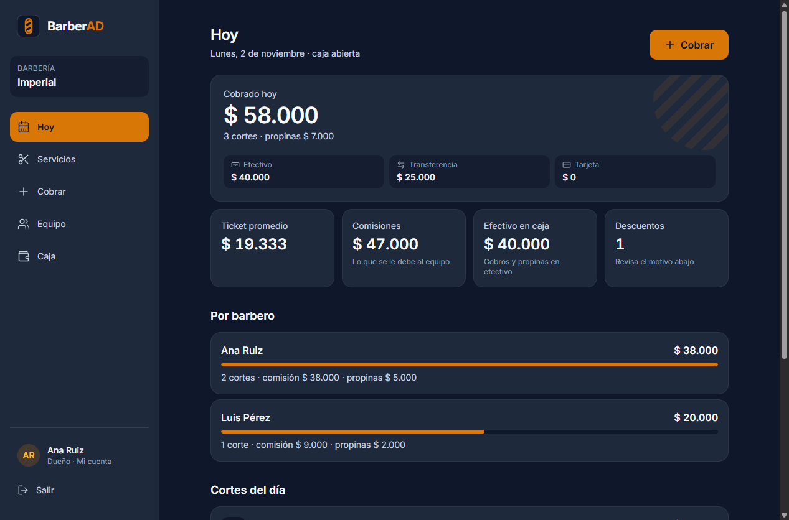
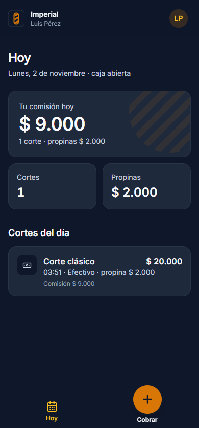

<p align="center">
  
</p>

<p align="center">
  Caja de una barbería para usarla de pie, con el celular en la mano.
</p>

El dueño registra la barbería, arma la carta de servicios, mete al equipo, cobra un corte y cierra la caja del día. Cada barbero entra con su correo y solo ve sus cortes y su comisión.



<table>
  <tr>
    <td width="68%"></td>
    <td width="32%"></td>
  </tr>
  <tr>
    <td>Cobrar: servicio, monto y pago, con la propina aparte.</td>
    <td>El barbero en el celular: su comisión del día.</td>
  </tr>
</table>

## Arrancar

Hace falta Node.js 20 o superior.

```bash
npm install
npm run dev
```

Abre http://localhost:3000

`npm run dev` enciende Postgres en esta máquina, crea la base `barberad` si no existe, aplica las migraciones y levanta la app. Los datos quedan en `data/` y no se suben. El puerto es el 5433, para no chocar con un Postgres que ya tengas. La primera vez descarga el binario y puede tardar.

Entra por http://localhost:3000/registro. La contraseña pide al menos 8 caracteres.

## Qué se puede hacer

**El dueño**

- **Registro.** Su nombre, el de la barbería, el correo y la contraseña.
- **Guía de inicio.** Al entrar, Hoy muestra cuatro pasos: armar la carta, cobrar el primer corte, sumar al equipo y completar los datos de la barbería. Se marcan solos y la guía desaparece cuando están todos, o antes si la oculta.
- **Servicios.** Nombre, duración y precio en pesos enteros. Trae plantillas de un toque (corte clásico, fade, barba, corte + barba, infantil, cejas) y cada servicio se puede editar o desactivar.
- **Equipo.** Cada barbero con su correo, una contraseña inicial y su porcentaje de comisión. Después puede cambiarle la comisión, que aplica desde el siguiente cobro, o ponerle una contraseña nueva si la olvidó.
- **Hoy.** Las citas que faltan por atender, con botón para cobrarlas. Lo cobrado por método de pago, el ticket promedio, las comisiones que se le deben al equipo, el efectivo que debe haber en la gaveta, los descuentos con su motivo y lo que hizo cada barbero.
- **Caja.** El efectivo esperado contra el contado, con lo que sobra o falta, y los últimos siete cierres. Cerrada, ese día no recibe otro cobro.
- **Mi cuenta.** Teléfono y dirección de la barbería, y el cambio de contraseña.

- **Agenda.** El día de cada barbero con sus citas, quién reservó en línea, botón de WhatsApp y cancelar. Desde ahí también se agenda a mano.
- **Enlace de reservas.** Cada barbería tiene su página pública (`/r/nombre-de-la-barberia`): el cliente elige servicio, barbero o "con quien esté libre", día y hora, y deja su nombre y WhatsApp. Solo ve horas libres dentro del horario, y la base de datos impide que dos citas del mismo barbero se crucen. Un mismo número puede tener máximo 3 citas pendientes.
- **Horarios.** Quién recibe citas y de qué hora a qué hora trabaja cada día. Los barberos nuevos arrancan de lunes a sábado, de 9:00 a 19:00; el dueño también, si al registrarse marca que atiende.
- **De la cita al cobro.** Cada cita pasa de reservada a confirmada, en silla y atendida. "Terminar y cobrar" abre el cobro con el servicio, el barbero y el precio de la cita; al confirmar, la cita queda atendida y no se puede cobrar dos veces. Si el dueño cobra la cita de un barbero, el cobro y la comisión quedan a nombre del barbero. "No vino" se marca cuando ya pasó la hora. El botón de WhatsApp abre un mensaje listo para confirmar la cita.
- **Clientes.** Se crean solos al reservar. Visitas, próxima cita, notas y WhatsApp.

**El barbero**

- **Cobrar.** Servicio, valor y método: efectivo, transferencia o tarjeta. Si el valor baja del precio, pide el motivo del descuento. La propina va aparte y no entra en la comisión.
- **Hoy.** Su comisión, sus cortes y sus propinas del día. No ve lo de los demás.
- **Agenda.** Solo la suya. Puede agendar y cancelar sus propias citas.

**Cualquiera**

- **Recuperar la contraseña.** Pide un enlace con su correo. El enlace dura 30 minutos, sirve una sola vez y al usarlo cierra la sesión en todos los dispositivos.

## Cómo se cuidan los datos

- Cada barbería solo lee y escribe lo suyo. Lo hace cumplir Postgres con seguridad por filas, no solo el código: la app entra con un rol que no puede saltársela.
- Un cobro no se edita ni se borra después de guardado.
- Las contraseñas se guardan con hash. La sesión y los enlaces de recuperación se guardan como hash del token, nunca el token.
- El correo de recuperación responde lo mismo exista o no la cuenta.

## Configuración

`.env.example` trae valores para esta máquina y se lee solo. Para cambiarlos, copia ese archivo a `.env.local`. Lo que esté en `.env.local` pisa el ejemplo y no entra al repositorio.

| Variable | Para qué sirve |
| --- | --- |
| `PG_PORT` | Puerto de Postgres. Por defecto `5433`. |
| `PG_SUPER_PASSWORD` | Clave del usuario que crea la base. |
| `PG_APP_PASSWORD` | Clave del rol con el que entra la app. |
| `SESSION_SECRET` | Secreto con el que se guarda la sesión. |
| `APP_URL` | Dirección pública de la app, para armar el enlace de recuperación. |

Todavía no hay proveedor de correo. En local, el enlace para recuperar la contraseña sale en la consola donde corre `npm run dev`.

## Comandos

| Comando | Qué hace |
| --- | --- |
| `npm run dev` | Migra y abre el servidor en el puerto 3000. |
| `npm test` | Comprueba que una barbería no vea ni edite lo de otra, que un cobro no se pueda cambiar, que los enlaces de recuperación sirvan una sola vez, que la caja cuente un cobro que entra mientras se cierra y los topes de los montos. Usa la base `barberad_test`. |
| `npm run typecheck` | Revisa los tipos de todo el proyecto, pruebas incluidas. |
| `npm run db:migrate` | Aplica las migraciones pendientes sobre `barberad`. |
| `npm run build` | Compila. |
| `npm start` | Sirve la compilación. No enciende Postgres: para trabajar, usa `npm run dev`. |

Las migraciones viven en `db/migrations/` y se aplican en orden. Cada una corre una sola vez.

### Si no arranca Postgres

El Postgres embebido no corre como `root` (es lo normal dentro de un contenedor o un CI): usa un usuario sin privilegios. Además `initdb` pide el locale `en_US.UTF-8`; en una imagen mínima se crea con `localedef -i en_US -f UTF-8 en_US.UTF-8`.

## Límites

Un cobro, un precio o una propina pueden llegar hasta $10.000.000; el efectivo contado al cerrar, hasta $1.000.000.000. Los nombres, hasta 80 caracteres; el motivo de un descuento, hasta 120; la contraseña, entre 8 y 200.

## Antes de publicar

Lo que hoy impide poner la app en un servidor:

- **Base de datos.** La app solo se conecta a un Postgres local (`127.0.0.1`, bases `barberad` y `barberad_test`). Falta leer una `DATABASE_URL` y apuntar a un Postgres administrado.
- **Secretos.** `.env.example` se lee como valores por defecto, incluido `SESSION_SECRET`. En producción debe fallar si no se define uno propio.
- **Correo.** Sin proveedor de correo, recuperar la contraseña no funciona en producción (el enlace solo sale en la consola).
- **Intentos de entrada.** No hay límite de intentos en entrar ni en pedir enlaces de recuperación.
- **Copias de seguridad** y monitoreo de errores.

## Lo que sigue

- **Anular un cobro.** Un cobro mal cargado (valor, servicio o método) hoy no tiene arreglo desde la app. Hace falta una anulación del dueño, con motivo, que quede registrada sin tocar el cobro original.
- **Reabrir o cobrar tarde.** Cerrada la caja, ese día no admite más cobros hasta la medianoche. Un cliente que llega después del cierre no se puede cobrar.
- **Historial.** Hoy solo muestra el día en curso. Faltan los días anteriores, la semana y el mes, y poder bajarlo a una hoja de cálculo.
- **Reactivar a un barbero** desactivado. Su correo queda ocupado y no se puede volver a registrar.
- **Cobrar sin señal.** Si se va la señal, el cobro no se guarda. La clave del cobro ya permite reintentar sin duplicar; falta guardarlo en el celular y enviarlo al volver.
- **Liquidación de comisiones** por semana o quincena.
- **Instalación en el celular.** El ícono es solo SVG; faltan PNG de 192 y 512 px y el ícono de Apple.
- **Política de tratamiento de datos** (Ley 1581).
- Agenda con reservas desde un enlace público.
- Recordatorios por WhatsApp.
- Planes y cobro de la suscripción.
